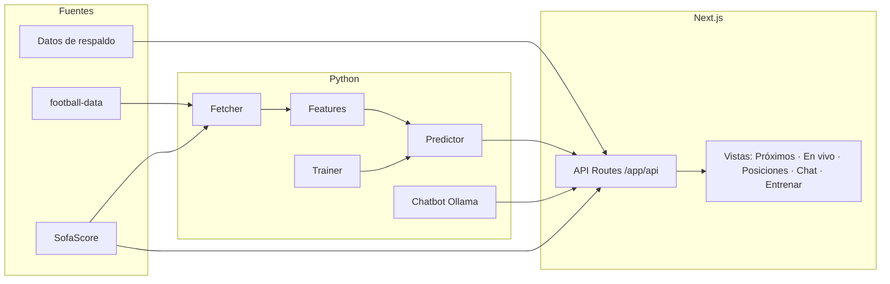

<div align="center">

# ⚽ AiPredict

**IA para predecir partidos de fútbol y construir parlays con criterio**
Predicciones con modelo propio · Partidos en vivo · Tablas de posiciones · Chatbot analista con LLM local


</div>

> ⚠️ **Aviso:** Prediict es una herramienta de análisis y apoyo a la decisión. Las predicciones son
> estimaciones probabilísticas, **no certezas ni garantías de ganancia**. Las apuestas conllevan
> riesgo de pérdida; juega con responsabilidad y solo si es legal en tu jurisdicción.

---

## 📌 Índice

- [¿Qué es?](#-qué-es)
- [Características](#-características)
- [Cómo funciona](#-cómo-funciona)
- [Estructura del proyecto](#-estructura-del-proyecto)
- [Inicio rápido](#-inicio-rápido)
- [API](#-api)
- [Parlays: cómo ayuda la IA](#-parlays-cómo-ayuda-la-ia)
- [Fuentes de datos y respaldo](#-fuentes-de-datos-y-respaldo)
- [Entrenamiento del modelo](#-entrenamiento-del-modelo)
- [Roadmap](#-roadmap)

---

## 🎯 ¿Qué es?

Prediict combina un **modelo de predicción** entrenado con datos de fútbol, **información en vivo**
y un **chatbot analista** (LLM local con Ollama) para ayudarte a evaluar partidos y armar parlays
de forma informada: ver probabilidades, contexto de cada equipo y el riesgo acumulado de combinar
varios resultados.

## ✨ Características

| Módulo | Qué hace |
|---|---|
| 🔮 **Predictor** | Estima probabilidades de resultado de un partido a partir de features de ambos equipos. |
| 📅 **Próximos partidos** | Calendario por liga con acceso directo a la predicción de cada encuentro. |
| 🔴 **En vivo** | Partidos en curso con estadísticas en tiempo real por partido. |
| 🏆 **Posiciones** | Tablas de clasificación por liga. |
| 💬 **Chatbot analista** | Pregunta en lenguaje natural sobre equipos, partidos y parlays; responde con LLM local. |
| 🧠 **Entrenamiento** | Vista para entrenar/reentrenar el modelo desde la propia interfaz. |
| 🟢 **Indicador de estado** | Muestra si backend, fuentes de datos y Ollama están disponibles. |
| 🛟 **Datos de respaldo** | Si una fuente externa falla, la app sigue funcionando con datos de reserva. |

## 🏛️ Cómo funciona



## 🗂️ Estructura del proyecto

```
Prediict/
├── app/                        # Next.js (App Router)
│   ├── api/                    # Endpoints: chat, leagues, live, predict, standings,
│   │                           #            status, teams, upcoming
│   ├── layout.tsx
│   ├── page.tsx
│   └── globals.css
├── backend/                    # Lógica de predicción en Python
│   ├── config.py               # Configuración
│   ├── core/
│   │   ├── features.py         # Ingeniería de features
│   │   └── predictor.py        # Modelo de predicción
│   ├── data/
│   │   ├── fetcher.py          # Descarga de datos
│   │   └── sofascore.py        # Integración con SofaScore
│   ├── training/
│   │   └── trainer.py          # Entrenamiento del modelo
│   └── chatbot/
│       └── ollama_chat.py      # Chatbot con Ollama
├── components/                 # Componentes React
│   ├── views/                  # live-view, standings-view, train-view, upcoming-view
│   ├── ui/                     # Librería shadcn/ui
│   ├── app-sidebar.tsx
│   ├── prediction-card.tsx
│   ├── predictor-panel.tsx
│   ├── chatbot-panel.tsx
│   ├── live-panel.tsx · live-matches-panel.tsx
│   ├── standings-panel.tsx · upcoming-panel.tsx
│   ├── league-selector.tsx
│   └── status-indicator.tsx
├── lib/                        # Clientes y utilidades
│   ├── api-client.ts
│   ├── data-sources.ts
│   ├── football-data.ts
│   ├── sofascore.ts
│   ├── ollama.ts
│   ├── fallback-data.ts
│   └── utils.ts
├── hooks/                      # use-mobile, use-toast
├── public/                     # Íconos y assets
├── SETUP.md                    # Guía de configuración detallada
├── components.json             # Configuración de shadcn/ui
├── package.json · pnpm-lock.yaml
└── next.config.mjs · tsconfig.json · postcss.config.mjs
```

## 🚀 Inicio rápido

### Requisitos

- **Node.js** 18+ y **pnpm**
- **Python** 3.10+ (backend de predicción)
- **Ollama** instalado (para el chatbot)

### 1. Clonar e instalar

```bash
git clone https://github.com/<tu-usuario>/Prediict.git
cd Prediict
pnpm install
```

### 2. Configurar variables de entorno

Crea un archivo `.env.local` en la raíz (revisa `SETUP.md` para la lista completa de variables
y claves de API necesarias):

```env
# Ejemplo — ajusta a tu configuración
OLLAMA_URL=http://localhost:11434
FOOTBALL_DATA_API_KEY=tu_api_key
```

### 3. Preparar el LLM local

```bash
ollama pull llama3.1
```

### 4. Backend de Python

```bash
cd backend
python -m venv .venv && source .venv/bin/activate   # Windows: .venv\Scripts\activate
pip install -r requirements.txt                     # si aplica
```

### 5. Levantar la app

```bash
pnpm dev
```

Abre **http://localhost:3000**

> 📖 Los pasos exactos de configuración (claves, puertos, arranque del backend) están en
> [`SETUP.md`](./SETUP.md).

## 🔌 API

Rutas de Next.js expuestas en `app/api/`:

| Método | Endpoint | Descripción |
|---|---|---|
| GET | `/api/status` | Estado del sistema (backend, fuentes de datos, Ollama) |
| GET | `/api/leagues` | Ligas disponibles |
| GET | `/api/teams/{league}` | Equipos de una liga |
| GET | `/api/standings` · `/api/standings/{league}` | Tabla de posiciones (general o por liga) |
| GET | `/api/upcoming` · `/api/upcoming/{league}` | Próximos partidos (general o por liga) |
| GET | `/api/live` | Partidos en vivo |
| GET | `/api/live/{matchId}/stats` | Estadísticas en vivo de un partido |
| POST | `/api/predict` | Predicción de un partido |
| POST | `/api/chat` | Conversación con el chatbot analista |

## 🎰 Parlays: cómo ayuda la IA

Un parlay multiplica probabilidades: **cada pata adicional reduce la probabilidad total de acertar**.
Por eso Prediict se enfoca en ayudarte a decidir con información, no en prometer aciertos:

- 📊 Muestra la **probabilidad estimada** de cada selección.
- 🔗 Permite considerar cómo se **combinan** varias patas y qué riesgo acumulado implica.
- 💬 El chatbot explica el razonamiento detrás de cada predicción y señala **qué podría invalidarla**.
- ✋ Si faltan datos, lo indica en lugar de inventar un resultado.

> 💡 Regla práctica: pocas patas, selecciones con respaldo de datos y una cantidad que estés
> dispuesto a perder.

## 🛟 Fuentes de datos y respaldo

| Fuente | Uso |
|---|---|
| **football-data** (`lib/football-data.ts`) | Ligas, equipos, resultados, calendarios y posiciones |
| **SofaScore** (`lib/sofascore.ts`, `backend/data/sofascore.py`) | Partidos en vivo y estadísticas |
| **Datos de respaldo** (`lib/fallback-data.ts`) | Reserva cuando una fuente falla, para que la interfaz siga operativa |

El indicador de estado de la interfaz refleja en todo momento qué fuentes están activas.

## 🧠 Entrenamiento del modelo

El modelo se entrena con `backend/training/trainer.py`, usando las features definidas en
`backend/core/features.py`. También puede lanzarse desde la vista **Entrenar** de la interfaz.

```bash
python -m backend.training.trainer
```

> Reentrena periódicamente con resultados recientes para que el modelo no quede desactualizado.

## 🗺️ Roadmap

- [x] Predicciones por partido
- [x] Próximos partidos, posiciones y partidos en vivo
- [x] Chatbot analista con Ollama
- [x] Vista de entrenamiento
- [ ] Constructor de parlays con probabilidad combinada
- [ ] Historial y seguimiento de predicciones acertadas/falladas
- [ ] Más ligas y mercados (goles, ambos anotan, hándicap)

---

<div align="center">

**Prediict** · Datos antes que corazonadas · Juega con responsabilidad

</div>
